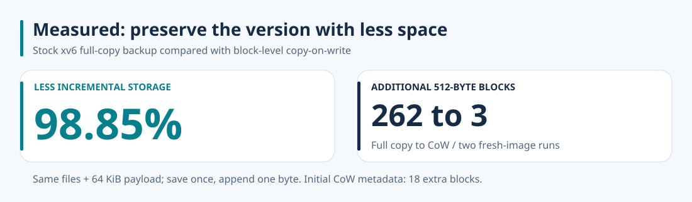
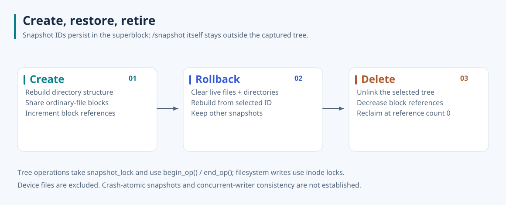
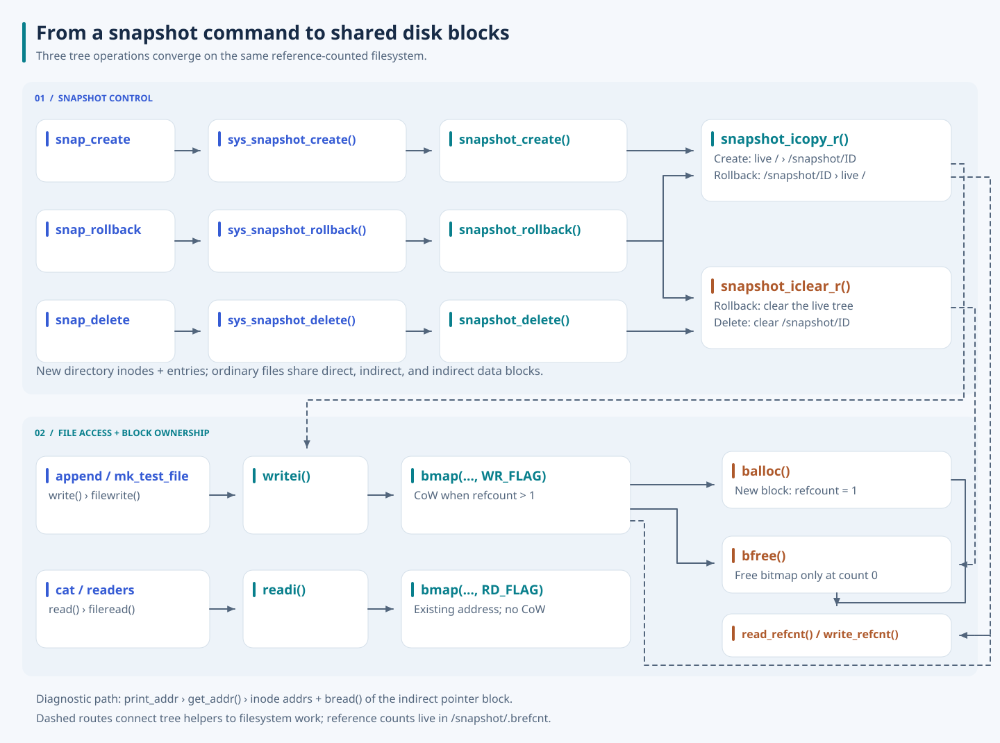

# xv6 Filesystem Snapshots

**Keep an earlier filesystem state without copying every file's contents.** I extended xv6's filesystem with block-level copy-on-write, persistent block reference counts, and commands to create, restore, and delete snapshots.



[Method, measured values, and reproduction](docs/measurements.md).

A full copy spends space on bytes that have not changed. This implementation separates the directory tree from the data it names: a snapshot receives new inodes and directory entries, while ordinary files initially share their disk blocks with the live tree. A later write copies the shared block being changed, leaving the saved version intact.


## What the extension makes possible

Snapshots appear under `/snapshot/01`, `/snapshot/02`, and subsequent IDs. They can be inspected with ordinary xv6 commands. Creating a snapshot captures ordinary files and directories below `/`; restoring one reconstructs the live tree from that version; deleting one releases its references and reclaims blocks whose count reaches zero.

The result is visible at both levels: directory listings show the saved namespace, and `print_addr` shows whether two files still share physical blocks. In a fresh QEMU run, a 6,150-byte file shared all 12 direct blocks, its indirect pointer block, and its first indirect data block with snapshot 01. Appending to the live file changed only the indirect pointer and affected data block; the snapshot retained both original addresses. Rollback restored those addresses, and deletion removed the snapshot directory.



## Design: ownership follows the disk block

Stock xv6 can free a block when an inode no longer needs it. Sharing changes that rule: one inode disappearing must not invalidate another inode's data. I added a `uint` reference count for each filesystem block, stored at `block_number * sizeof(uint)` in `/snapshot/.brefcnt`. The modified [image builder](xv6-public/mkfs.c) creates that metadata file and initializes references for blocks already used by the boot image.

The current image contains 2,000 blocks and 200 disk inodes. Its count array needs 8,000 bytes; the image builder rounds the metadata file to 8,192 bytes across 16 data blocks. The superblock also stores `snapshot_next_id`, so a normal reboot continues ID allocation. This is an extended disk format: build a filesystem image with this project's `mkfs` before using the kernel.

The allocation and release paths in [fs.c](xv6-public/fs.c) implement the ownership rule:

- Allocation marks the bitmap, zeros the new block, and initializes its reference count to 1.
- Snapshot cloning increments counts for direct data blocks, the single indirect pointer block, and every referenced indirect data block.
- Release decrements the count first. The bitmap is cleared only when no references remain.

### Put CoW at the mapping boundary

I added a read/write mode to `bmap`, where a file's logical block number becomes a disk-block address. `readi` requests `RD_FLAG`; `writei` requests `WR_FLAG`. Reading an existing block returns its address without CoW or reference-count updates. Writing an unshared block uses the existing address. Writing a shared block allocates a new block, copies all 512 bytes, records the copy in the xv6 log, replaces the live pointer, and releases one reference to the old block.

An indirect write can change two things: an entry in the pointer block and the contents of its target data block. The implementation first makes a shared indirect pointer block private, then applies the same ownership check to the target. Copying only the data block would leave the saved inode's pointer array exposed to live edits.

The reference-count file has a special write path to avoid recursively asking for its own counts while updating metadata. Reads likewise bypass CoW, preventing the `bmap → read_refcnt → readi → bmap` cycle from becoming recursive reference accounting.

## Design: rebuild the namespace, share the contents

The recursive helpers in [snapshot.c](xv6-public/snapshot.c) handle tree construction and removal. Directory inodes start with empty block lists; `.` and `..` plus child entries are rebuilt. Ordinary-file inodes receive copied metadata and shared block pointers. `/snapshot`, traversal entries, and device files are excluded from capture, so a snapshot neither captures itself nor duplicates the live console device.

Rollback clears the live ordinary-file and directory tree, then copies the chosen saved tree back with writable modes. Other snapshots and the snapshot metadata remain in place. Delete clears only the selected saved tree and unlinks its ID entry. Neither operation consumes the selected version merely by restoring it.



This redraw retains the report's create, rollback, delete, and file-access paths. It expands the command-to-handler boundary and separates `print_addr`'s actual diagnostic route: `get_addr` reads inode addresses and the indirect block directly, while ordinary readers use `readi` and `bmap(RD_FLAG)`.

### Preserve saved files as read-only

I reuse the inode `minor` field for mode bits on ordinary files and directories, while device inodes retain its device meaning. Snapshot copies receive `MODE_RDONLY`; restored copies receive writable file or directory modes. The [file syscall layer](xv6-public/sysfile.c) checks parent-directory write permission before creating entries, and refreshes file read/write permissions from inode mode when resolving a descriptor. `filewrite` rejects a non-writable descriptor. Unlink and link checks also protect snapshot entries and metadata.

For example, `append snapshot/01/f1 BAD` and `mkdir snapshot/01/nope` both fail with `Permission Denied` in the demo. `append` uses `O_CREATE`, so its existing-file attempt also passes through the parent-directory check. Plain `open(O_WRONLY)` on a snapshot file is not itself rejected by a general inode-mode check in `sys_open`; the later descriptor/write path enforces the mode. This implementation does not claim a complete Unix permission model.

## Run it

Use Linux or WSL with Make, GCC capable of emitting 32-bit x86 code, binutils, and `qemu-system-i386`. GCC 9 was used for the validation below.

```bash
cd xv6-public
make CC=gcc-9 xv6.img fs.img
make CC=gcc-9 CPUS=1 qemu-nox
```

At the xv6 shell, start with a fresh image:

```text
mk_test_file f1
print_addr f1
snap_create
print_addr snapshot/01/f1
append f1 UPDATED
print_addr f1
print_addr snapshot/01/f1
append snapshot/01/f1 BAD
mkdir snapshot/01/nope
snap_rollback 1
print_addr f1
snap_delete 1
ls snapshot
```

`mk_test_file` writes 12 full blocks and six extra bytes, deliberately crossing into indirect addressing. Compare addresses instead of assuming that block numbers are stable across builds. Exit QEMU with **Ctrl+A, then X**. The generated `fs.img` retains changes across emulator restarts; removing and rebuilding it resets the demo.

## Results and remaining boundaries

The documented QEMU run used one virtual CPU. It confirmed the following behavior:

| Operation | Observed result |
| --- | --- |
| Create snapshot 01 | Live and saved files have identical direct and indirect addresses. |
| Append to the live file | Direct addresses remain shared; the indirect pointer and modified data block diverge. |
| Attempt saved-tree modifications | Append with `O_CREATE` and directory creation are rejected. |
| Restore snapshot 01 | The live file points to the saved version's blocks again. |
| Delete snapshot 01 | Its directory disappears; `/snapshot/.brefcnt` remains. |
| Restart the same disk image | The next create returns ID 2, preserving the ID sequence. |

The development report also records multiple snapshots, nested-directory restoration, link/unlink rejection, and inode exhaustion followed by snapshot deletion and another create attempt. These are historical demonstrations; the table above describes the fresh validation. The separate [storage comparison](docs/measurements.md) measures bitmap growth against a full-copy baseline; it does not measure throughput.

A new overwrite probe exposed a persistence gap: `bmap` can replace a shared direct-block address, but `writei` only calls `iupdate` when the file grows. A first-byte overwrite of a saved file returned success yet the live file showed its original byte after reboot. CoW writes that replace an inode address without extending the file therefore cannot be treated as durable. The measured append grows the file, persists its changed pointers, and passes byte-for-byte saved-content checks after shutdown.

Snapshot operations take a sleep lock and participate in xv6's `begin_op` / `end_op` log protocol. Ordinary writers do not take that global snapshot lock. These mechanisms do not establish a consistent capture under arbitrary concurrent writers or a crash-atomic snapshot of an arbitrarily large tree: the log and inode pool remain bounded. Top-level create failures attempt cleanup, but recursive clone return values are not propagated everywhere, and rollback can already have cleared live entries when an error occurs. Hard-linked names are cloned separately rather than preserving their shared inode identity; existing open descriptors and working directories are not redirected to newly restored inodes.

## Source and API

| Area | Where to read |
| --- | --- |
| Recursive snapshot operations and serialization | [snapshot.c](xv6-public/snapshot.c) |
| Block mapping, CoW, reference counts, allocation and release | [fs.c](xv6-public/fs.c) |
| Initial disk layout and reference metadata | [mkfs.c](xv6-public/mkfs.c), [fs.h](xv6-public/fs.h) |
| Mode checks and diagnostic block-address access | [sysfile.c](xv6-public/sysfile.c), [stat.h](xv6-public/stat.h) |
| Commands | [snap_create.c](xv6-public/snap_create.c), [snap_rollback.c](xv6-public/snap_rollback.c), [snap_delete.c](xv6-public/snap_delete.c), [print_addr.c](xv6-public/print_addr.c) |

The user-facing calls are `snapshot_create()`, `snapshot_rollback(id)`, `snapshot_delete(id)`, and `get_addr(fd, buffer)`. Successful tree operations return the relevant positive snapshot ID; failures return `-1`. `get_addr` exposes the direct addresses, indirect pointer, and indirect data addresses for inspection.

Figures are custom SVGs with outlined Noto Sans labels; the [font license](docs/assets/NotoSans-OFL.txt) is included. The original Word report and extracted screenshots are reference material only. Upstream xv6 information and acknowledgments remain in [xv6-public/README](xv6-public/README). See the [collection](https://github.com/jaeunda/xv6-kernel-extensions) for the other kernel extensions.
