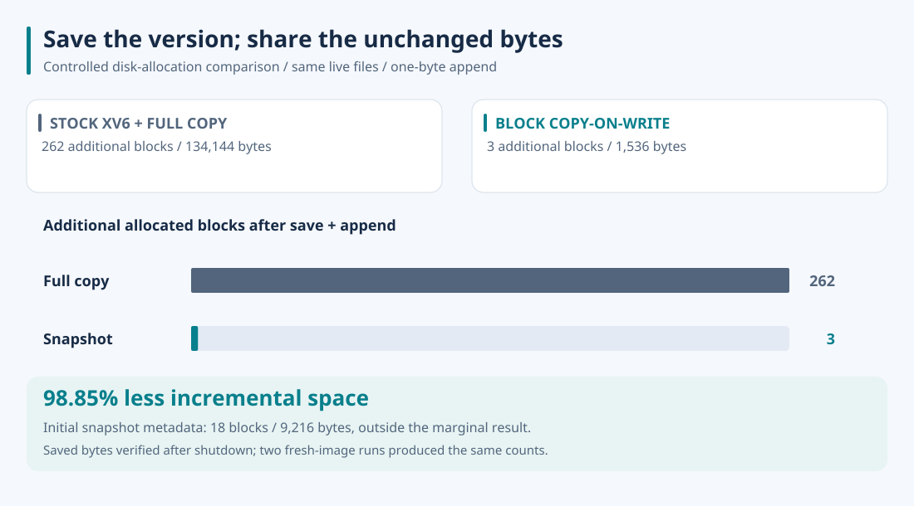

# Measuring the space saved by sharing unchanged blocks

**A saved namespace and one-byte append needed 3 additional blocks instead of 262.** I compared this kernel with a full-copy backup implemented through stock xv6's ordinary file API. Stock xv6 has no snapshot command, so the baseline is the space required to preserve the same ordinary-file namespace by copying it.



## Result

| Allocated 512-byte blocks | Stock xv6 + full copy | Snapshot kernel |
| --- | ---: | ---: |
| Prepared live filesystem | 350 | 368 |
| After saving the namespace | 611 | 369 |
| After appending one live byte | 612 | 371 |
| Additional blocks: save only | 261 | 1 |
| Additional blocks: save + append | **262** | **3** |

The additional-space reduction is `(262 - 3) / 262 × 100 = 98.85%`: 134,144 bytes versus 1,536 bytes. Snapshot creation allocates one saved-directory block; appending to the 64 KiB payload makes its shared indirect pointer block private and allocates one new data block. Existing file bodies remain shared.

The 18-block difference before saving is a separate upfront cost: 16 reference-count data blocks, their indirect pointer block, and the snapshot directory. It is included in the absolute counts above and excluded from the **incremental** headline. For this fixture, the final allocated totals are 612 versus 371 blocks. Both images have 2,000 blocks, 200 disk inodes, and a 60-block log; the host image-file lengths are fixed, so this is filesystem allocation, not a reduction in the host `fs.img` file size.

Two independent fresh-image runs produced the same six absolute counts and the same saved-byte verification outcome. [Recorded runs](measurements.json) include the per-file hashes and compiler/emulator versions. This is a deterministic allocation comparison, not a throughput benchmark or a claim about every workload.

## Controlled fixture and verification

The images contain byte-identical `README`, `init`, `sh`, and `storage` files plus a deterministic 65,536-byte payload. The baseline copies every ordinary root file into `/saved`; the extension captures the same ordinary-file namespace in `/snapshot/01`. Device files and traversal entries are excluded. The temporary stock build uses the extension's filesystem and log capacities while retaining stock allocation, file-writing, and scheduling algorithms.

The runner counts set bits in the on-disk allocation bitmap after preparation, saving, and a one-byte append. Each stage finishes and QEMU stops before the image is read; later stages boot the same disk again. It verifies that every saved file retains exactly its original bytes, that the live payload equals the original payload plus `X`, and that the ordinary-file hashes match between the two input namespaces. All kernel code under comparison remains unchanged; the guest fixture and image contents are assembled in temporary directories.

An exploratory first-byte overwrite did **not** pass the persistence check: `bmap` changed an in-memory inode pointer but `writei` did not call `iupdate` because the size stayed constant. The live byte reverted after reboot. This defect is documented in the README, and the reported experiment specifically tests growing writes. It does not establish overwrite durability, crash atomicity, or consistent capture during concurrent mutation.

## Reproduce

Install Python 3, Make, binutils, GCC 9 with 32-bit x86 output, and `qemu-system-i386`. The recorded environment used GCC 9.5.0, QEMU 8.2.2 with its default software emulation, one virtual CPU, and 512 MiB guest RAM. Start in this repository's root:

```bash
git clone https://github.com/mit-pdos/xv6-public.git /tmp/xv6-stock
git -C /tmp/xv6-stock checkout eeb7b415dbcb12cc362d0783e41c3d1f44066b17
python3 xv6-public/benchmarks/measure.py \
  --baseline /tmp/xv6-stock \
  --output /tmp/xv6-storage-result
```

The output directory must not exist. The runner checks the pinned baseline and creates all builds, disk images, build logs, guest transcripts, and `results.json` there. It leaves both source checkouts untouched. [Fixture](../xv6-public/benchmarks/storage.c) · [Runner](../xv6-public/benchmarks/measure.py) · [Pinned upstream](https://github.com/mit-pdos/xv6-public/tree/eeb7b415dbcb12cc362d0783e41c3d1f44066b17).
